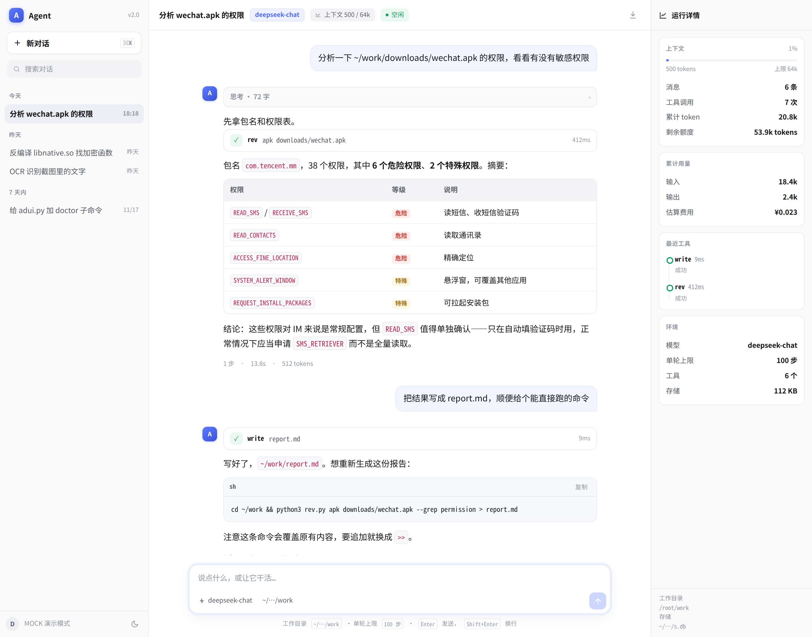
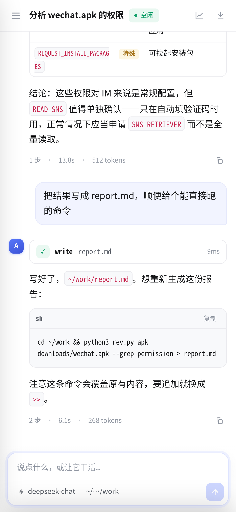
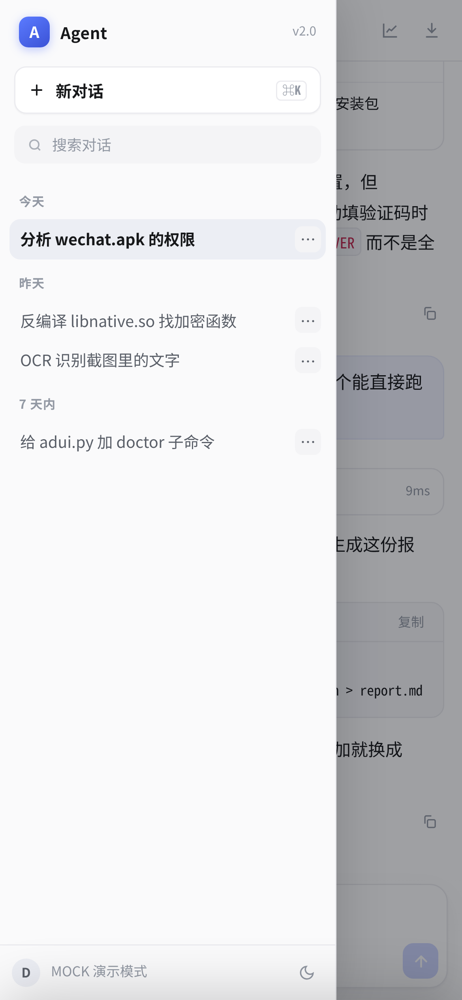
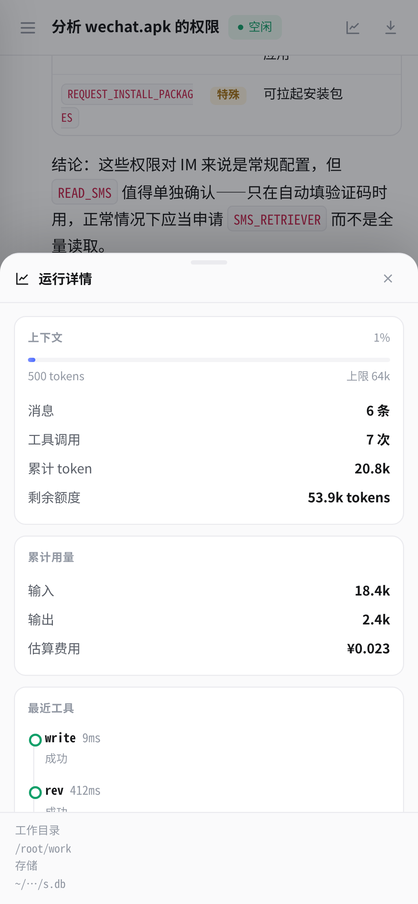

# webchat 前端与记忆重构方案

> 针对三个问题：**界面粗糙、没有跨会话记忆、运行信息不可见**。  
> 目标形态见 `prototype.html`（可点击原型）与 `shots/` 下渲染图。  
> 约束：仍然跑在 Termux / 鸿蒙 Linux 虚拟机上，**不引入构建链、不装第三方 Python 包**，全部用标准库。

---

## 一、先把问题定位准

现在这三个毛病不是三件事，是同一件事的三个面：`webchat.py` 把「服务端状态」和「界面状态」都塞进了两个全局变量里。

```python
STATE = {"msgs": [], "events": [], "lock": threading.Lock()}
```

| 现象 | 真实原因 | 位置 |
|---|---|---|
| 界面丑 | 单栏布局，只有 header + 消息流 + 输入框；没有导航、没有层级、没有信息密度 | `HTML` 常量，全内联 |
| 没有记忆 | `STATE["msgs"]` 是进程内存，**进程一退就没了**；`/api/reset` 直接置空 | L76、L431 |
| 只能一个对话 | 全局只有一个 `msgs`，新对话 = 覆盖旧的 | L76、L312 |
| 什么都看不到 | 只有 header 一个 `sub` 文本，`done` 事件时才闪一下步数和耗时；token 完全没统计 | L798-801 |

所以改造的核心不是"美化 CSS"，而是**把会话变成一等公民**：有了 `session` 这个实体，列表、恢复、搜索、切换、统计全都自然长出来，界面才有东西可展示。

---

## 二、目标形态





### 桌面（三栏）

```
┌──────────┬──────────────────────────────┬──────────┐
│ 会话列表  │  标题 · 模型 · 上下文 · 状态   │ 运行详情  │
│ 264px    ├──────────────────────────────┤ 286px    │
│          │  消息流（最大 748px 居中）      │ 上下文    │
│ 新对话    │   ├ 思考块（折叠）             │ 进度/token│
│ 搜索      │   ├ 工具卡（可展开输出）        │ 本轮统计  │
│ 今天/昨天 │   ├ Markdown / 表格 / 代码块    │ 工具时间线│
│ 更早      │   └ 消息页脚（步数·耗时·token） │ 运行环境  │
│          ├──────────────────────────────┤          │
│ 用户      │  输入框 + 附件/计划/模型        │ 工作目录  │
└──────────┴──────────────────────────────┴──────────┘
```

### 移动端

侧栏变抽屉（左滑/点 ☰），右侧详情变底部弹层（点 📈），输入框吸底。

<div class="gallery">



</div>
<div class="cap">左：对话 · 中：会话抽屉 · 右：运行详情弹层</div>

**关键取舍**：桌面用三栏是为了"信息可见"；手机屏幕装不下，所以把「运行详情」做成**按需弹出的底部面板**，而不是塞进消息流里。

---

## 三、记忆层：SQLite 单文件

### 3.1 为什么是 SQLite

| 方案 | 问题 |
|---|---|
| JSON 文件整读整写 | 每次追加要重写全文件；1 万条消息时每次 20MB 写入，手机上会卡 |
| 内存 + 退出时落盘 | 进程被 kill / 虚拟机重启 / 断电 → 全丢，正是现在的痛点 |
| **SQLite（WAL）** | 标准库 `sqlite3`，Termux 自带；单文件；单条 INSERT < 1ms；支持并发读；崩溃安全 |

路径：`~/.local/share/webchat/sessions.db`（跟 `~/.config/webchat/env` 分开，配置归配置、数据归数据）。

### 3.2 表结构

```sql
PRAGMA journal_mode = WAL;
PRAGMA synchronous  = NORMAL;
PRAGMA busy_timeout = 3000;
PRAGMA foreign_keys = ON;

CREATE TABLE IF NOT EXISTS sessions (
  id          TEXT PRIMARY KEY,        -- 20261119-194802-7f3a
  title       TEXT NOT NULL,           -- 首条消息前 24 字，可改
  created_at  INTEGER NOT NULL,
  updated_at  INTEGER NOT NULL,
  pinned      INTEGER DEFAULT 0,
  archived    INTEGER DEFAULT 0,
  model       TEXT,
  work        TEXT,                    -- 当时的工作目录，换目录也说得清
  steps       INTEGER DEFAULT 0,       -- 累计工具调用次数
  tokens_in   INTEGER DEFAULT 0,
  tokens_out  INTEGER DEFAULT 0
);

CREATE TABLE IF NOT EXISTS messages (
  id           INTEGER PRIMARY KEY AUTOINCREMENT,
  sid          TEXT NOT NULL REFERENCES sessions(id) ON DELETE CASCADE,
  seq          INTEGER NOT NULL,       -- 会话内单调递增，断线续传靠它
  role         TEXT NOT NULL,          -- system / user / assistant / tool
  content      TEXT,
  reasoning    TEXT,                   -- 思考内容单独存，不污染 content
  tool_calls   TEXT,                   -- JSON 原样
  tool_call_id TEXT,
  name         TEXT,
  tokens       INTEGER DEFAULT 0,
  latency_ms   INTEGER DEFAULT 0,
  created_at   INTEGER NOT NULL,
  UNIQUE(sid, seq)
);

CREATE INDEX IF NOT EXISTS idx_msg_sid_seq ON messages(sid, seq);
CREATE INDEX IF NOT EXISTS idx_sess_upd    ON sessions(archived, pinned DESC, updated_at DESC);

-- 搜索（FTS5 不可用时降级为 LIKE）
CREATE VIRTUAL TABLE IF NOT EXISTS msg_fts USING fts5(
  content, sid UNINDEXED, tokenize='unicode61'
);
```

**三条设计要点：**

1. **`messages` 存 API 原样的消息对象**，重启后能 1:1 还原成 `msgs` 数组直接喂给模型。不要存"渲染后的 HTML"——那就再也恢复不了上下文了。
2. **`reasoning` 单独一列**。原因：DeepSeek 的 `reasoning_content` 不能回传给 API，混在 `content` 里会导致下一轮 400。
3. **`seq` 单调递增**，前端增量拉取用 `?after_seq=120`，断线重连不用重拉全量。

### 3.3 写入时机（这决定数据会不会丢）

| 时机 | 动作 |
|---|---|
| 用户发消息 | `INSERT` user 消息 → `sessions.updated_at` |
| 流式输出中 | **不落库**。delta 只在内存里拼，避免每条 token 一次写盘 |
| 一轮助手回复结束 | `INSERT` assistant 消息（含 content / reasoning / tool_calls） |
| 每次工具执行完 | `INSERT` tool 消息 + `sessions.steps += 1` |
| 进程退出 / Ctrl+C | `atexit` 兜底 flush 未落库的当前消息 |

### 3.4 崩溃后的"半条消息"——必须处理

这是最容易踩的坑。如果进程在「assistant 发了 tool_calls，但 tool 结果还没写回」时被杀，数据库里就是：

```
assistant: {tool_calls: [...]}   ← 后面没有对应的 tool 消息
```

下次启动直接把这串发给 API → **400 Bad Request**，会话就永久打不开了。

启动时（或打开会话时）做一次修复：

```python
def repair(sid):
    rows = db.execute("SELECT role, tool_calls, tool_call_id FROM messages "
                      "WHERE sid=? ORDER BY seq DESC LIMIT 1", (sid,)).fetchone()
    if not rows:
        return
    role, tcs, _ = rows
    if role == "assistant" and tcs:
        for tc in json.loads(tcs):
            db.execute("INSERT INTO messages(sid,seq,role,tool_call_id,content,created_at) "
                       "VALUES(?,?,?,?,?,?)",
                       (sid, next_seq(sid), "tool", tc["id"],
                        "（任务被中断，没有拿到结果）", int(time.time())))
```

前端同时在这一条上标一个"已中断"的灰条，用户点"继续"就能接着跑。

### 3.5 上下文恢复与压缩

- **恢复**：打开会话 → `SELECT ... ORDER BY seq` → 拼成 `msgs` → 直接可继续对话，模型"记得"之前聊了什么。
- **压缩**（二期）：`messages` 超过 60 条或估算 token 超过模型上限 70% 时，把最老的一半交给模型总结成一段 `system` 摘要，存进 `sessions.summary`；发送时用「摘要 + 最近 30 条」替代全量。原始消息仍留在库里，只是不参与请求。

### 3.6 旧数据迁移

老版本没有库。加一次性逻辑：启动时若发现 `sessions.db` 不存在且内存/旧 dump 里有消息，写一条 `session` + 若干 `message`，标题取首条 user 消息前 24 字。跑一次就够，之后不再触发。

---

## 四、后端 API

| 方法 | 路径 | 说明 |
|---|---|---|
| GET | `/api/sessions?q=&limit=50` | 会话列表，按 pinned、updated_at 排序；`q` 走 FTS |
| POST | `/api/sessions` | 新建，返回 `{id,title}` |
| PATCH | `/api/sessions/{id}` | 改标题 / 置顶 / 归档 |
| DELETE | `/api/sessions/{id}` | 删除（级联删消息） |
| GET | `/api/sessions/{id}/messages?after_seq=0` | 拉消息，支持增量 |
| POST | `/api/sessions/{id}/chat` | 发消息，返回 SSE |
| POST | `/api/sessions/{id}/stop` | 中止当前任务 |
| GET | `/api/sessions/{id}/stats` | 上下文占用、步数、token、工具时间线 |
| GET | `/api/health` | 版本、模型、工作目录、库大小 |

### 4.1 SSE 事件协议（在现有基础上扩充）

```
user      {v}                      用户消息回显
think     {v}                      思考增量
delta     {v}                      正文增量
tool      {id,name,args}           工具开始
tool_end  {id,out,ms,ok}           工具结束（新增 ok）
usage     {in,out,total}           本轮 token（新增）
title     {v}                      自动标题（新增）
done      {steps,turns,ms,hit_limit,stopped}
error     {v}
```

`usage` 的来源：DeepSeek 兼容 OpenAI 的流式用量，请求体加

```python
"stream_options": {"include_usage": True}
```

最后一个 chunk 会带 `usage: {prompt_tokens, completion_tokens}`。拿不到时用估算兜底：

```python
def est_tokens(s):
    cjk = sum(1 for ch in s if '\u4e00' <= ch <= '\u9fff')
    return int(cjk * 1.05 + (len(s) - cjk) / 3.6)
```

### 4.2 断线重连（刷新页面不丢正在跑的任务）

现在的问题：任务在后台跑，前端一刷新就白屏，只能等它跑完再点历史。

做法：**每个会话一个事件环形缓冲 + 自增 seq**。

```python
class Bus:
    def __init__(self):
        self.seq = 0
        self.buf = collections.deque(maxlen=3000)
        self.subs = []
        self.lock = threading.Lock()

    def pub(self, ev):
        with self.lock:
            self.seq += 1
            ev["seq"] = self.seq
            self.buf.append(ev)
            subs = list(self.subs)
        for q in subs:
            q.put(ev)
```

- 前端发 `GET /api/sessions/{id}/stream?last_seq=1200`，服务端先把 `buf` 里 `seq > 1200` 的重放，再挂上订阅。
- SSE 带 `id: {seq}`，浏览器 EventSource 自动带 `Last-Event-ID`。
- 页面加载时先拉 `stats` 判断 `running`，是则自动接流。

这一步做完，"手机上锁屏再打开，任务还在跑"就是自然结果。

### 4.3 并发与中止

- 同一 `sid` 同时只允许一个 run，重复请求返回 `409`，前端提示"当前会话正在运行"。
- 不同 `sid` 可并发（`ThreadingHTTPServer` 天然支持），但共享工作目录，写文件可能打架——方案里约定 agent 单任务串行，跨会话并发只读。
- `stop`：置 `threading.Event`，agent 循环每步 `if stop.is_set(): break`，收尾发 `done{stopped:true}`，并把已产生的部分回复落库。

---

## 五、前端重构

### 5.1 文件组织：从单文件拆成四个

现在 `webchat.py` 已经 39KB，再把新界面塞进去会破 80KB，改一行要在 HTML 字符串里翻半天。

```
webchat.py        # 服务 + agent 循环（约 25KB）
static/app.html   # 结构（约 6KB）
static/app.css    # 样式（约 12KB）
static/app.js     # 逻辑（约 18KB）
```

`webchat.py` 里加一个静态文件服务（读不到就用内置兜底，保证单文件也能跑）。`update.sh` 的 `FILES` 加三行即可，它本来就是逐文件比对下载。

如果坚持单文件：把 `HTML` 改成 `render_index()`，用 `%s` 注入 CSS/JS 三段常量，至少代码分区清楚。

### 5.2 视觉规范（对齐 DeepSeek / ChatGPT 的观感）

不做花哨设计，靠**克制**取胜：

| 项 | 值 |
|---|---|
| 主色 | `#4d6bfe`（只用于：发送键、选中态、链接、运行中脉冲点） |
| 背景 | 主区 `#fff`，侧栏 `#fafafb`，卡片 `#fff` + 1px 边框 |
| 圆角 | 气泡 14px（右下角 4px 制造方向感）、卡片 11px、按钮 9px |
| 字号 | 正文 15/1.72，元信息 11，工具名 12 等宽 |
| 阴影 | 只有输入框有：`0 1px 2px rgba(16,24,40,.04), 0 8px 24px rgba(16,24,40,.05)` |
| 助手消息 | **不要气泡**，直接文本贴底（ChatGPT/Claude 风格，长文更好读） |
| 用户消息 | 浅蓝气泡 `#f2f4ff` + `#e6e9fb` 边，右对齐 |
| 深色 | `prefers-color-scheme` 自动切换，`color-scheme: light dark` 一并声明 |

### 5.3 组件行为

**思考块**：默认折叠，只显示「已思考 2.4s」；运行中自动展开，结束后自动收起（可手动固定展开）。

**工具卡**：一行显示 `工具名 + 参数摘要 + 耗时 + 状态`。
- 运行中：左侧转圈，整卡半透明
- 成功：绿色 ✓，点击展开输出
- 失败：红色 ✕，**默认自动展开**（错误必须一眼看到）
- 同类连续调用合并成一组（如连续 5 次 `read_file` 折叠成「读取 5 个文件」）

**消息页脚**：`4 步 · 18.6s · 2,180 tokens`，hover 出现「复制 / 重新生成 / 分支」。移动端常驻显示。

**输入框**：`Enter` 发送、`Shift+Enter` 换行（现在的实现有 `isComposing` 判断，保留，中文输入法不会误发）；上方一行常驻提示：工作目录、单轮步数上限、快捷键。

### 5.4 渲染性能

现在的 `flush()` 每帧 `cur.innerHTML = md(curRaw)`——长回复时每帧重排整段 Markdown，手机上会掉帧。

改成：
1. 流式期间只 `appendChild(document.createTextNode(chunk))`，纯文本，零重排；
2. 收到 `done` 或遇到 ``` 代码块边界时才渲染一次 Markdown；
3. 历史消息超过 60 条时只渲染最近 60 条 + 顶部「加载更早」按钮。

### 5.5 Markdown 补强

现有 `md()` 缺三样：**代码块语言标签、复制按钮、嵌套列表**。

代码块外面包一层 `.codewrap`：

```html
<div class="codewrap">
  <div class="codehead"><span class="lg">sh</span>
    <button data-code="...">复制</button></div>
  <pre><code>...</code></pre>
</div>
```

复制用 `navigator.clipboard.writeText`，失败降级 `document.execCommand('copy')`（Termux 的 WebView 有时不给 clipboard 权限）。

---

## 六、token 与成本可见

用户抱怨"什么信息都看不到"，本质是**不知道这次任务花了多少**。三个层级：

| 层级 | 展示位置 | 内容 |
|---|---|---|
| 单条回复 | 消息页脚 | 这次回复几步、多久、多少 token |
| 单轮任务 | 顶部 chip + 右侧面板 | 累计步数、总耗时、输入/输出 token |
| 整个会话 | 右侧「上下文」卡 | 已用 / 上限、百分比进度条、按当前速度还能聊多少轮 |

估算值要标"≈"，真实值来自 `usage` 事件；两者偏差超过 20% 时用真实值校准系数并写回配置。

---

## 七、分阶段落地

| 阶段 | 内容 | 工时 | 可独立验收 |
|---|---|---|---|
| **P0** | SQLite 存储 + 会话 CRUD API + 侧栏列表 + 顶部信息条 + token 统计 | 4-6h | 重启进程，历史还在；能切会话 |
| **P1** | 三栏布局 + 工具卡/思考块/消息页脚 + 右侧详情 + 深色 + 移动端抽屉 | 1d | 界面对齐原型图 |
| **P2** | 断线重连 + stop + 自动标题 + 搜索 + 导出 md | 4-6h | 跑任务时刷新页面，流继续 |
| **P3** | 上下文压缩、重新生成/分支、多模型切换 | 1d | 长会话不爆上下文 |

P0 做完就已经解决"没有记忆"，P1 解决"丑和看不见"，两者可并行（一个人改后端、一个人改前端，接口按第四节对齐）。

---

## 八、风险与注意

1. **会话库 = 全部历史命令**。`webchat.py` 本来就没有鉴权，现在等于把"你在这台机器上干过的所有事"也存下来了。`--host 0.0.0.0` 时同网段任何人可读。**建议 P1 一并加一个简单 token**：启动时生成随机串写进 `~/.config/webchat/env`，前端 URL 带 `?k=`，或校验 Cookie；不带则 401。
2. **SQLite 并发**：单写多读没问题，但必须 `WAL + busy_timeout`，否则两个浏览器标签同时写会 `database is locked`。
3. **FTS5 可能不可用**：部分 Android 自带的 SQLite 没编 FTS5。启动时 `CREATE VIRTUAL TABLE` 失败就 catch，搜索降级成 `LIKE '%q%'`（数据量小，够用）。
4. **磁盘**：单条消息平均 2KB，1 万条约 20MB。加一个"清理 90 天前归档会话"的定时任务即可。
5. **`--mock` 模式要跟着改**：现在 mock 只造两轮假数据，新前端要能展示工具卡/思考块/统计，mock 得造完整事件序列，否则没 key 时看不到界面效果。
6. **别把 `seq` 做成全局自增**。必须是会话内自增，否则切换会话后 `after_seq` 全乱。

---

## 九、验收清单

- [ ] 关掉进程、重启虚拟机，打开页面仍是上次的会话，且能接着聊
- [ ] 左侧有会话列表，按今天/昨天/更早分组，点一下切换，上下文不串
- [ ] 搜索"apk"，能命中三天前那次会话
- [ ] 长任务跑到第 12 步时刷新页面，进度条和输出接着走，不中断
- [ ] 每条回复下面能看到步数 / 耗时 / token
- [ ] 右侧面板显示上下文占用百分比，超过 70% 变黄
- [ ] 工具执行失败时卡片自动展开并标红
- [ ] 手机上侧栏是抽屉，详情是底部弹层，输入框不遮挡最后一条消息
- [ ] 深色模式跟随系统，代码块和表格对比度正常
